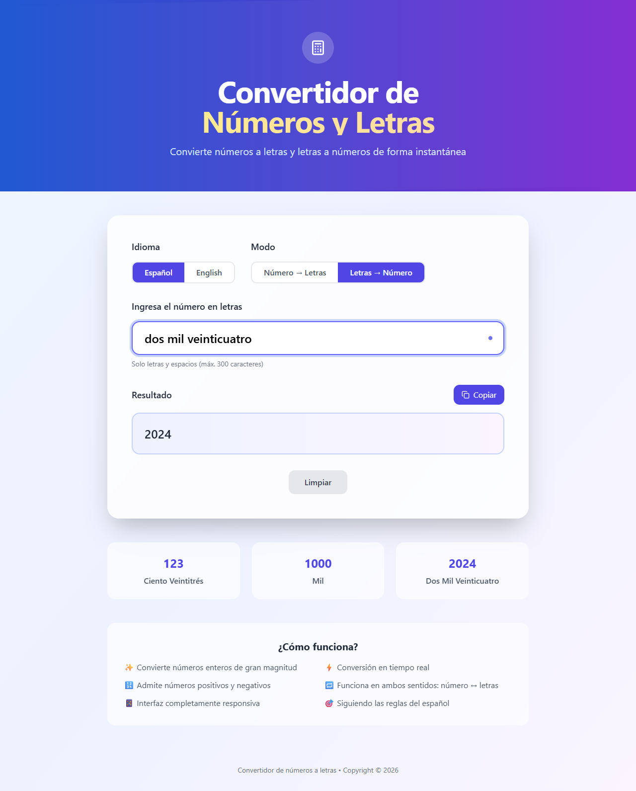
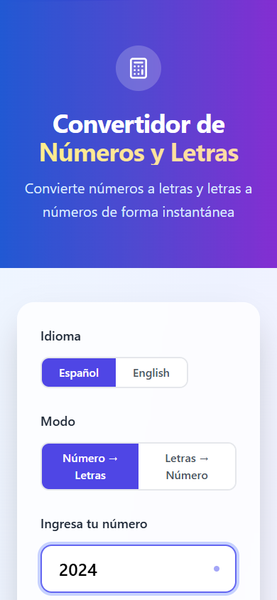
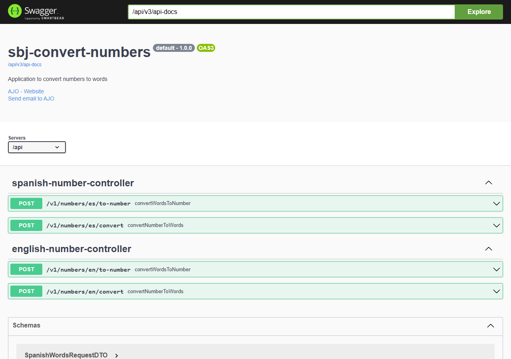
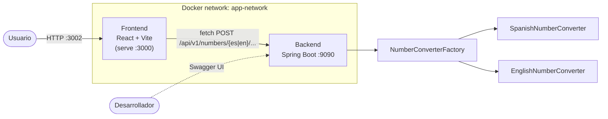
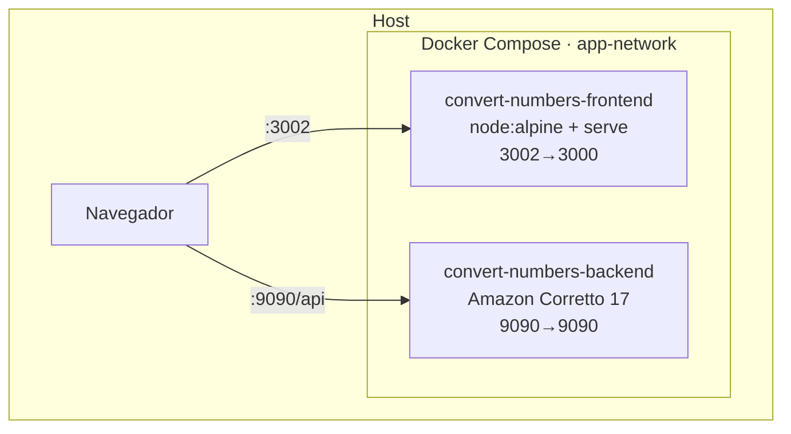
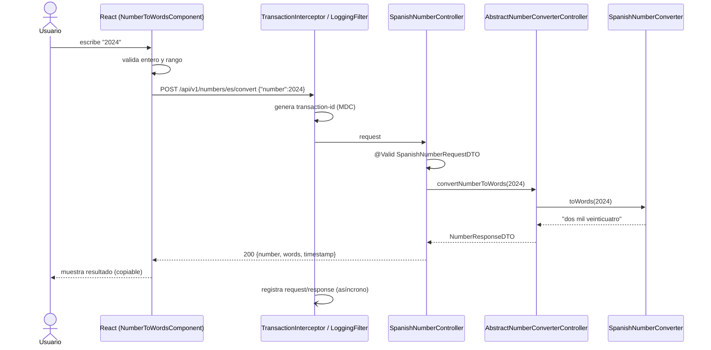
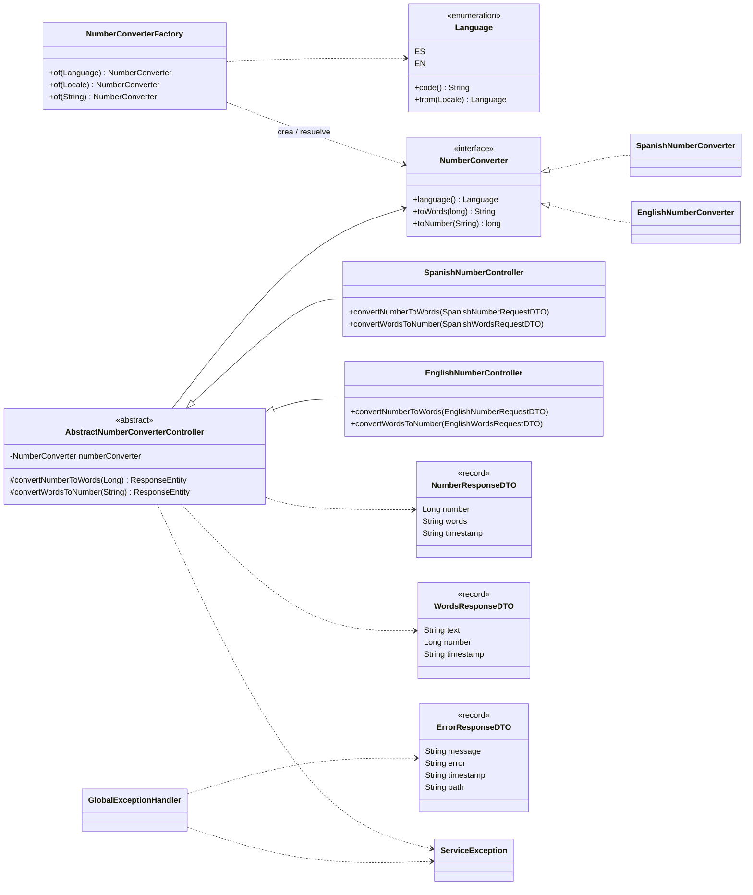
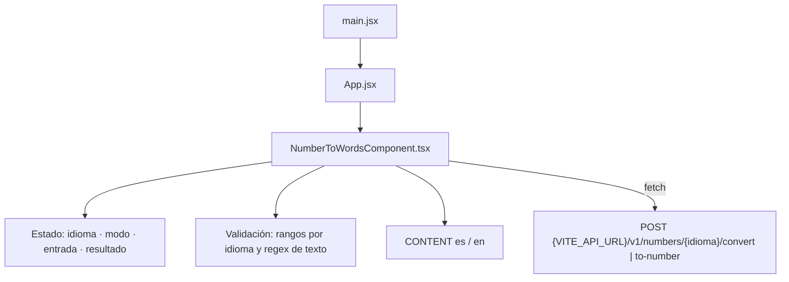

# Numbers Converter

Aplicación web que convierte **números a letras** y **letras a números**, en **español** e **inglés**.
Está formada por dos proyectos independientes que se orquestan con Docker Compose:

| Proyecto | Descripción | Stack | Puerto |
|----------|-------------|-------|--------|
| [`sbj-convert-numbers`](./sbj-convert-numbers) | API REST con la lógica de conversión | Java 17, Spring Boot 3.5.4, Maven | `9090` |
| [`react-convert-numbers`](./react-convert-numbers) | Interfaz web | React 19, TypeScript, Vite, Tailwind CSS | `3002` (host) → `3000` (contenedor) |


## Capturas de pantalla

| Número → Letras (ES) | Letras → Número (ES) |
|---|---|
|  |  |

| Número → Words (EN) | Vista móvil |
|---|---|
|  |  |

Documentación interactiva de la API (Swagger UI):



## Estructura del repositorio

```
numbers_converter/
├── docker-compose.yml          # Orquesta backend y frontend
├── docs/images/                # Capturas usadas en este README
├── sbj-convert-numbers/        # Backend (Spring Boot)
└── react-convert-numbers/      # Frontend (React + Vite)
```

## Inicio rápido (Docker)

Requisitos: Docker y Docker Compose.

```bash
docker compose up -d --build
```

| Servicio | URL |
|----------|-----|
| Frontend | http://localhost:3002 |
| API | http://localhost:9090/api |
| Swagger UI | http://localhost:9090/api/swagger-ui/index.html |
| Health | http://localhost:9090/api/management/health |

Detener y eliminar los contenedores:

```bash
docker compose down
```

> **Nota sobre `VITE_API_URL`:** Vite incrusta esta variable en el bundle **en tiempo de compilación** y la
> ejecuta el navegador, no el contenedor. Por eso el `docker-compose.yml` la define como
> `http://localhost:9090/api` (URL del backend publicada en el host) y no con el nombre interno de la red
> Docker, que un navegador no puede resolver. Si despliegas en otro host, cambia `args.VITE_API_URL` y
> vuelve a ejecutar `docker compose up -d --build`.

## Prueba rápida de la API

```bash
curl -X POST http://localhost:9090/api/v1/numbers/es/convert \
  -H "Content-Type: application/json" -d '{"number": 2024}'
# {"number":2024,"words":"dos mil veinticuatro","timestamp":"..."}

curl -X POST http://localhost:9090/api/v1/numbers/en/to-number \
  -H "Content-Type: application/json" -d '{"text": "two thousand twenty-four"}'
```

## Arquitectura



### Diagrama de despliegue



### Diagrama de secuencia: número → letras



### Diagrama de clases (backend)



### Diagrama de componentes (frontend)



## Límites por idioma

| Idioma | Rango numérico | Escala |
|--------|----------------|--------|
| Español | −999 999 999 999 999 a 999 999 999 999 999 | larga (billón = 10¹²) |
| Inglés | −9 223 372 036 854 775 807 a 9 223 372 036 854 775 807 | corta (billion = 10⁹) |

El texto de entrada admite hasta 300 caracteres (letras y espacios; en inglés también guiones).

## Documentación detallada

- [Backend – `sbj-convert-numbers`](./sbj-convert-numbers/README.md)
- [Frontend – `react-convert-numbers`](./react-convert-numbers/README.md)
