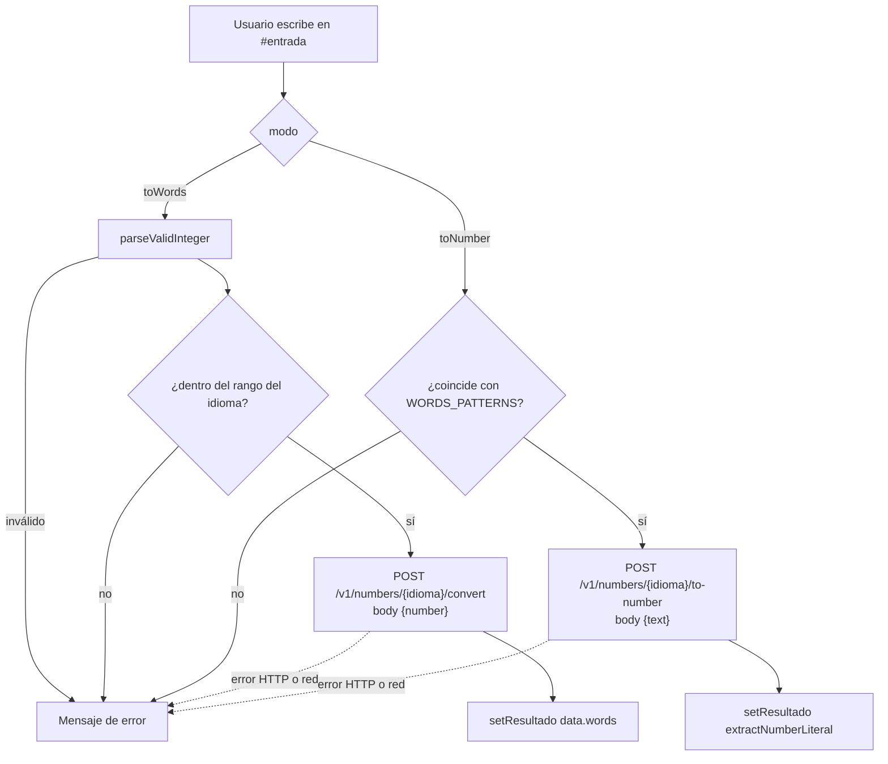
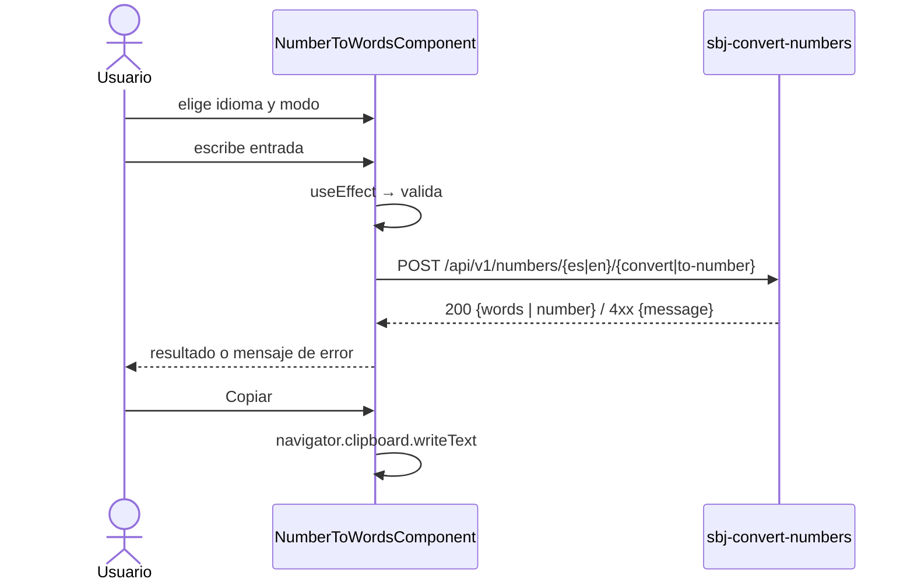

# react-convert-numbers

Interfaz web (React + TypeScript) para convertir **números a letras** y **letras a números** en español e inglés.
Consume la API de [`sbj-convert-numbers`](../sbj-convert-numbers).


## Características

- Selector de **idioma** (Español / English) y de **modo** (Número → Letras / Letras → Número).
- Conversión en tiempo real mientras se escribe.
- Validación en el cliente: entero válido, rango por idioma, y patrón de texto permitido (máx. 300 caracteres).
- Copiar resultado al portapapeles, botón de limpiar y ejemplos clicables.
- Interfaz responsiva e i18n completa (es/en).

| Número → Letras (ES) | Letras → Número (ES) |
|---|---|
|  |  |

| Number → Words (EN) | Móvil |
|---|---|
|  |  |

## Stack

React 19 · TypeScript · Vite · Tailwind CSS 4 · lucide-react · ESLint

## Configuración

| Variable | Descripción | Valor por defecto |
|----------|-------------|-------------------|
| `VITE_API_URL` | URL base de la API | `http://localhost:9090/api` |

Vite incrusta la variable **al compilar** (`.env` o `--build-arg` en Docker). Como la usa el navegador, debe
apuntar a una URL accesible desde el host (no a un nombre interno de la red Docker).

## Desarrollo local

```bash
npm install
npm run dev        # http://localhost:5173
npm run build      # genera dist/
npm run preview
npm run lint
```

Requiere el backend en ejecución (por defecto `http://localhost:9090/api`). El backend tiene CORS abierto.

## Docker

Con el stack completo, desde la raíz del repositorio padre:

```bash
docker compose up -d --build        # UI en http://localhost:3002
```

Solo el frontend:

```bash
docker network create -d bridge services-net
docker build --no-cache -f Dockerfile \
  --build-arg VITE_API_URL=http://localhost:9090/api -t react-convert-numbers:0.0.1 .
docker run --network=services-net --name=react-convert-numbers -d -p 3000:3000 react-convert-numbers:0.0.1
docker rm -f react-convert-numbers  # eliminar
```

> `VITE_API_URL` se lee en tiempo de compilación; pásala con `--build-arg`. Un `--env-file` en `docker run`
> no afecta al bundle ya generado.

La imagen es multi-etapa: `node:alpine` compila con Vite y sirve `dist/` con `serve` en el puerto 3000.

## Arquitectura

```
src/
├── main.jsx                          # punto de entrada
├── App.jsx
└── components/
    └── NumberToWordsComponent.tsx    # estado, validación, i18n, llamadas a la API y UI
```

### Flujo del componente



### Secuencia



Nota: en modo letras → número, el valor se extrae del texto crudo de la respuesta (`extractNumberLiteral`) para
conservar la precisión de enteros mayores a 2⁵³ que `JSON.parse` redondearía; del mismo modo, el número se envía
como literal para no perder precisión.
