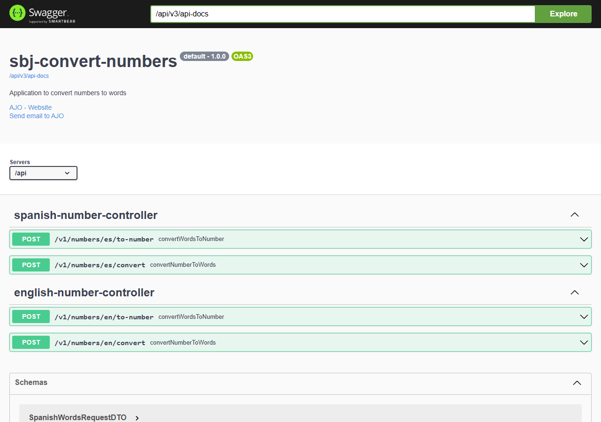
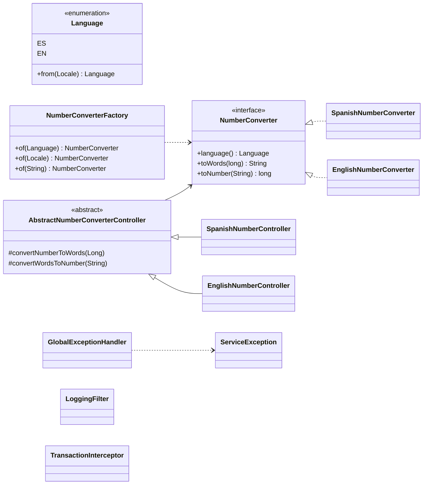
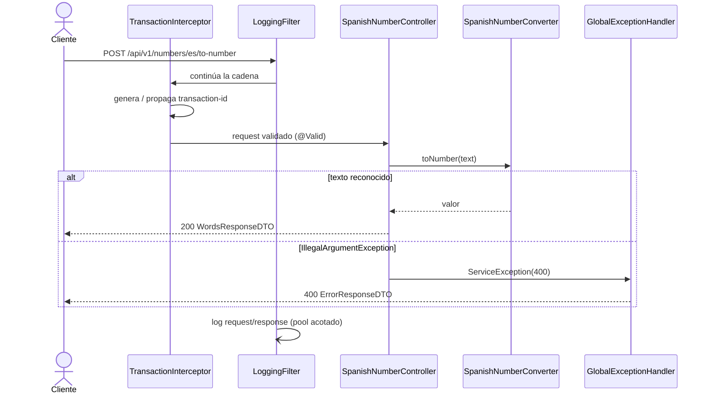

# sbj-convert-numbers

Microservicio REST (Spring Boot) que convierte números a su representación en letras y viceversa, en **español** e **inglés**.



## Stack

- Java 21 (Amazon Corretto), Spring Boot 4.0.1, Maven
- Bean Validation, Lombok, springdoc-openapi (Swagger UI)
- Checkstyle y JaCoCo (cobertura mínima de complejidad: 75 %)

## Configuración

| Propiedad | Valor |
|-----------|-------|
| Puerto | `9090` |
| Context path | `/api` |
| Swagger UI | http://localhost:9090/api/swagger-ui/index.html |
| OpenAPI JSON | http://localhost:9090/api/v3/api-docs |
| Health | http://localhost:9090/api/management/health |
| Zona horaria (Docker) | `America/Mexico_City` |

## Endpoints

| Método | Ruta | Cuerpo | Descripción |
|--------|------|--------|-------------|
| POST | `/api/v1/numbers/es/convert` | `{"number": 2024}` | Número → letras (español) |
| POST | `/api/v1/numbers/es/to-number` | `{"text": "dos mil veinticuatro"}` | Letras → número (español) |
| POST | `/api/v1/numbers/en/convert` | `{"number": 2024}` | Número → letras (inglés) |
| POST | `/api/v1/numbers/en/to-number` | `{"text": "two thousand twenty-four"}` | Letras → número (inglés) |

### Ejemplos

```bash
curl -X POST http://localhost:9090/api/v1/numbers/es/convert \
  -H "Content-Type: application/json" -d '{"number": 2024}'
```
```json
{ "number": 2024, "words": "dos mil veinticuatro", "timestamp": "2026-10-25 15:40:14" }
```

```bash
curl -X POST http://localhost:9090/api/v1/numbers/en/to-number \
  -H "Content-Type: application/json" -d '{"text": "two thousand twenty-four"}'
```
```json
{ "text": "two thousand twenty-four", "number": 2024, "timestamp": "2026-10-25 15:40:30" }
```

Errores (validación, texto no reconocido) devuelven `ErrorResponseDTO`:
`{ "message", "error", "timestamp", "path" }`.

### Validaciones

| Idioma | Rango de `number` | `text` |
|--------|-------------------|--------|
| ES | −999 999 999 999 999 … 999 999 999 999 999 | letras (incluye acentos, ñ, ü) y espacios simples, máx. 300 |
| EN | −9 223 372 036 854 775 807 … 9 223 372 036 854 775 807 | letras, espacios y guiones, máx. 300 |

Al convertir letras a número se ignoran mayúsculas y acentos (`TextUtils.normalize`).
`Long.MIN_VALUE` se rechaza explícitamente para evitar desbordamiento al negar.

## Arquitectura

```
com.juniverse.numbers
├── controller/   AbstractNumberConverterController, SpanishNumberController, EnglishNumberController
├── service/      NumberConverter (interfaz), Spanish/EnglishNumberConverter, NumberConverterFactory, LoggingService
├── dto/          Request/Response records por idioma, ErrorResponseDTO
├── enums/        Language (ES, EN)
├── config/       CORS, Swagger, filtros, AppConfig
├── filter/       LoggingFilter (asíncrono), TransactionInterceptor (transaction-id vía MDC)
├── exception/    GlobalExceptionHandler, ServiceException
└── util/         TextUtils, DateUtil, Constants
```

### Diagrama de clases



### Flujo de una petición



## Desarrollo local

```bash
mvn spring-boot:run                          # ejecutar
mvn clean test                               # pruebas + cobertura (target/jacoco-report/)
mvn checkstyle:check                         # calidad de código (120 columnas, Javadoc)
mvn clean package -Dmaven.test.skip=true     # empaquetar sin pruebas
```

## Docker

Desde la raíz del repositorio padre (backend + frontend):

```bash
docker compose up -d --build
```

Solo el backend:

```bash
docker network create -d bridge services-net
docker build --no-cache -f Dockerfile -t sbj-convert-numbers:1.0.0 .
docker run --network=services-net --name=sbj-convert-numbers -d -p 9090:9090 sbj-convert-numbers:1.0.0
docker rm -f sbj-convert-numbers      # eliminar
```

La imagen usa build multi-etapa (Maven → Corretto 21) y arranca con `run.sh`, que aplica opciones de
seguridad (`java.security.egd`) y de Netty.
